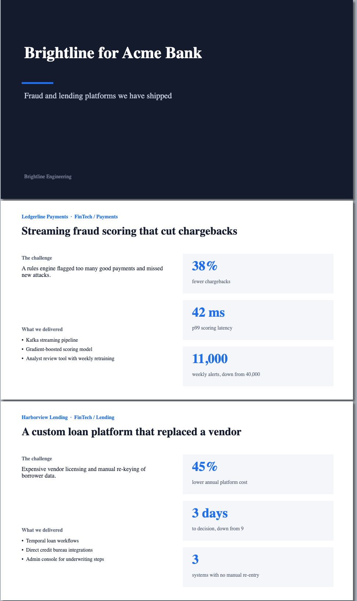
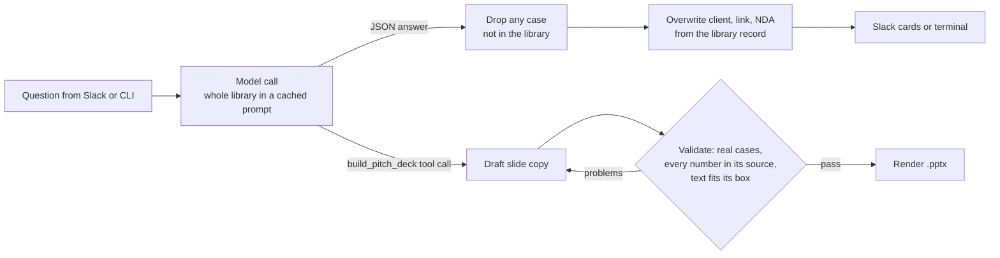

# Casebook

A Slack assistant that helps a sales team find the right past projects for a prospect, and builds a pitch deck from them. Every answer comes from a library of case studies, and deterministic checks make sure nothing invented reaches a user or a slide.

This is a public, generic version of a system I built and run in production at [Zoolatech](https://zoolatech.com), where it answers questions over 100+ case studies. The code is rewritten from scratch for this repo. The company, clients, and case studies here (Brightline Engineering, Ledgerline Payments, and so on) are fictional.



## What it does

**Search.** Ask in Slack or the terminal:

```
$ python -m casebook ask "A trucking company wants fewer late deliveries. Which cases fit?"

Crossroads Freight: Route Optimization for a Regional Delivery Fleet
  Link: https://example.com/cases/crossroads-route-optimization   NDA: No
  Results: On-time delivery rate improved from 86% to 97%; 17% fewer miles driven per delivery
  Why it fits: Same problem (late deliveries) in the same industry.
```

**Decks.** Describe a prospect and get a `.pptx` with the best-fitting cases, written to fit the slide layout:

```
$ python -m casebook deck "Acme Bank: fraud losses are rising and loan approvals take two weeks" -o acme.pptx
Saved acme.pptx (2 cases: Real-Time Fraud Scoring for a Payments Processor, Loan Origination Platform Rebuild for a Digital Lender)
```

In Slack, the bot decides for itself whether a message is a search or a deck request, in any phrasing ("can u put together some slides for Northpoint"), using a tool call rather than keyword matching.

## How it works



| File | Job |
|---|---|
| [`casebook/corpus.py`](casebook/corpus.py) | Loads the library and looks cases up by title |
| [`casebook/prompts.py`](casebook/prompts.py) | The grounding rules, kept in one copy that every prompt builds from |
| [`casebook/llm.py`](casebook/llm.py) | One small interface over Anthropic and OpenAI, with prompt caching |
| [`casebook/search.py`](casebook/search.py) | Question to answer, plus the checks that run after the model |
| [`casebook/deck.py`](casebook/deck.py) | Brief to validated slide copy to `.pptx` |
| [`casebook/slack_blocks.py`](casebook/slack_blocks.py), [`slack_app.py`](casebook/slack_app.py) | Slack cards that respect Block Kit limits, and the bot |

## Design decisions

These came from things that went wrong in production.

**No vector database.** The library fits in the context window, so the model sees every case on every question. Retrieval would add a way to fail (missing the right case) without making answers better at this size. The full library is sent as a cached prompt prefix, so repeat questions are billed mostly at the cached-input rate. `Corpus.context()` is the one place retrieval would go if the library outgrew the window.

**The model chooses; Python checks.** The production bot once wrote a complete, convincing case study for a project that never existed, after a user pasted a detailed brief and asked "which case study is this?" The prompt now forbids that, but prompts are not guarantees. So after every answer, any case whose title is not in the library is dropped, and the fields a salesperson might forward to a client (client name, link, NDA status) are overwritten from the library record instead of trusting the model's copy.

**Every number on a slide is checked against its own case study.** A deck goes in front of a client. `validate_deck()` extracts each number from a case's slide and requires it to appear as a whole number in that same case's text. That catches numbers borrowed from another case and rounding (37% when the source says 38%). When a draft fails, the model gets the specific problems back and one chance to fix them.

**Slide text limits are enforced in code.** Models do not reliably count characters. Each text field has a limit measured against its box on the slide, and an overflowing field fails validation instead of breaking the layout.

**The model returns JSON; Python builds the Slack message.** Slack has no table block and rejects a whole message if one block is over its size limit. Building the cards in code keeps them under the limits and means the facts shown come from the library record.

**"Tell me more about that one" with no earlier conversation is answered without the model.** Sent to the model, a question that points at nothing gets a confident answer about some random real case, which the fabrication check cannot catch because the case is real.

## Testing

**Offline tests** (free, no API key, run in CI on every push) use a fake model that returns scripted responses, so each check is tested against exactly the failure it exists for:

```bash
pip install -e ".[dev]"
pytest
```

**Live evals** run real questions through the real model and score the answers: expected cases found, nothing invented, honest "no match" when nothing fits, no relabeling a retail case as fintech, correct routing between searches and deck requests, and decks that pass validation.

```bash
cp .env.example .env   # add an API key
python evals/run_evals.py
```

Each run writes a report with pass rate, latency, token usage, and cost to `evals/results/`. The test questions live in [`evals/search_cases.json`](evals/search_cases.json) and include traps, such as a pasted brief for a project that does not exist.

### Latest results

On `claude-haiku-5-5`, October 2026 ([full report](docs/eval_results.md)):

| Suite | Passed | Median time | Cost per request |
|---|---|---|---|
| Search (13 questions, including 4 traps) | 13/13 | 3.4 s | $0.0004 |
| Decks (3 prospect briefs) | 3/3 | 15.1 s | $0.0022 |

98% of input tokens were read from the prompt cache.

All three first drafts of a deck failed validation, every time because a caption or bullet ran past its box on the slide (for example, a 56-character caption in a 48-character box). Each was fixed in the repair round. This is why the length check exists: the model was told the limits and still went over them in every deck.

## Running it

```bash
python -m venv .venv && source .venv/bin/activate
pip install -e ".[dev]"
cp .env.example .env               # ANTHROPIC_API_KEY or OPENAI_API_KEY
python -m casebook ask "Which fintech projects used machine learning?"
python -m casebook deck "Regional bank that wants to cut fraud" -o pitch.pptx
```

For Slack, create an app with Socket Mode, the `app_mentions:read`, `chat:write`, `files:write`, `im:history`, and `channels:history` scopes, add the tokens to `.env`, then run `python -m casebook.slack_app`.

To use your own case studies, point `CASEBOOK_CORPUS` at a JSON file in the same format as [`data/case_studies.json`](data/case_studies.json).

## Differences from the production version

- Production reads case studies from Google Drive, rebuilds the library weekly, and hot-swaps it without a redeploy. Here the library is a JSON file.
- Production builds decks by copying a branded Google Slides template through the Slides API. Here they are rendered with `python-pptx`, so the project runs without a Google account.
- Production runs on Google Cloud Run behind Slack's Events API. Here the bot uses Socket Mode so it runs on a laptop.

## License

MIT
